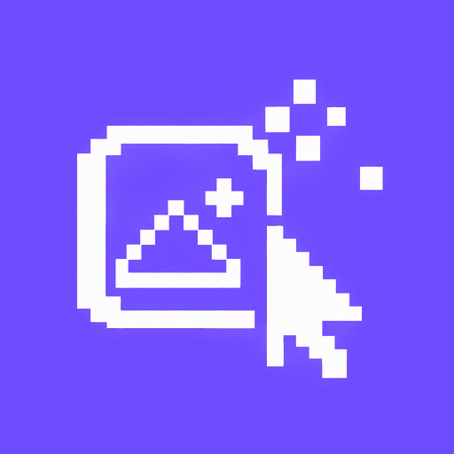

<p align="center">
  
</p>

<h1 align="center">femtopix</h1>

<p align="center">
  Gömülü ekranları tasarla, cihaz pikselinde gör, çalışan C/C++ koda dönüştür.<br>
  <em>Design for OLED / TFT / e-paper, preview real device pixels, export firmware-ready code.</em>
</p>

<p align="center">
  <a href="https://github.com/Muhammed-Turgut/ivec_draw/releases/latest"></a>
  <a href="https://github.com/Muhammed-Turgut/ivec_draw/releases/latest"></a>
  
  
</p>

<p align="center">
  <a href="https://github.com/Muhammed-Turgut/ivec_draw/releases/latest/download/femtopix-0.1.0-linux-x86_64.AppImage"><strong>Linux indir</strong></a>
  ·
  <a href="https://github.com/Muhammed-Turgut/ivec_draw/releases/latest/download/femtopix-0.1.0-windows-x64.zip"><strong>Windows indir</strong></a>
  ·
  <a href="https://github.com/Muhammed-Turgut/ivec_draw/releases/latest"><strong>Tüm sürümler</strong></a>
</p>

---

## Ne işe yarar?

femtopix, Arduino / ESP32 / STM32 gibi kartlardaki **küçük ekranlar** için bir masaüstü tasarım aracıdır.

Figma gibi çizersin: dikdörtgen, daire, yazı, ikon, piksel kalemi. Önizleme ise Photoshop gibi yumuşak değil — **cihazın gerçek çözünürlüğü ve renk derinliği** (1-bit OLED veya RGB565 TFT). Ekranda gördüğün, panelde görünecek olanla aynıdır.

Bitince alt panelden **u8g2, Adafruit GFX, TFT_eSPI, Arduino_GFX** C/C++ kodunu kopyalar veya şekil/ikon için `.h` dosyasını indirirsin. Hesap yok, bulut yok, internet gerekmez.

| Sen | femtopix |
| --- | --- |
| OLED / TFT arayüzü çizeceksin | Cihazı seç, ekranı tasarla |
| “Cihazda nasıl durur?” diye merak ediyorsun | Piksel ızgaralı önizleme |
| Firmware’e yapıştırmalık kod istiyorsun | Üretilen C/C++ + `.h` ikonlar |

## İndir

Hazır paketler [GitHub Releases](https://github.com/Muhammed-Turgut/ivec_draw/releases/latest) sayfasında.

| Platform | Paket | Ne yaparsın |
| --- | --- | --- |
| **Linux** (x86_64) | [femtopix-0.1.0-linux-x86_64.AppImage](https://github.com/Muhammed-Turgut/ivec_draw/releases/latest/download/femtopix-0.1.0-linux-x86_64.AppImage) | İndir, çalıştırılabilir yap, aç |
| **Windows** (x64) | [femtopix-0.1.0-windows-x64.zip](https://github.com/Muhammed-Turgut/ivec_draw/releases/latest/download/femtopix-0.1.0-windows-x64.zip) | Zip’i aç, `femtopix.exe` çalıştır; ilk açılışta kurulum sihirbazı gelir |

### Linux

```bash
chmod +x femtopix-0.1.0-linux-x86_64.AppImage
./femtopix-0.1.0-linux-x86_64.AppImage
```

Fedora / Ubuntu uygulama menüsüne almak istersen dosyayı `~/.local/bin/femtopix` olarak kopyalaman yeterli.

AppImage açılmazsa FUSE kapalı olabilir. Şunu dene:

```bash
./femtopix-0.1.0-linux-x86_64.AppImage --appimage-extract-and-run
```

### Windows

1. [femtopix-0.1.0-windows-x64.zip](https://github.com/Muhammed-Turgut/ivec_draw/releases/latest/download/femtopix-0.1.0-windows-x64.zip) dosyasını indir.
2. Klasöre çıkar, `femtopix.exe` çalıştır.
3. İlk açılışta kurulum sihirbazı sorar:
   - **Projeler nereye kaydedilsin?** (varsayılan: `Belgeler\femtopix`)
   - **Masaüstüne kısayol oluştur**
4. **Devam et** — ana ekran açılır.

Windows SmartScreen “tanınmayan uygulama” diyebilir: **Ek bilgi → Yine de çalıştır**. Paket imzalı değil; kaynak bu depo.

Uygulama klasörü + Başlat menüsü + masaüstü kısayolu olan klasik `.exe` kurulum, Windows’ta `npm run dist:win` ile üretilir.

## Nasıl kullanılır?

1. **Yeni proje** — Cihazı seç (SSD1306 128×64, SH1106, ST7789, özel çözünürlük) ve kod hedefini seç (u8g2, GFX, TFT_eSPI…).
2. **Çiz** — Alttaki araç çubuğu: seç (V), el (H), kalem (B), yazı (T), dikdörtgen, elips, çizgi, üçgen. Kalem **piksel piksel** boyar.
3. **İkon ekle** — Soldan Galeri (yalnızca SVG; cihaz boyutuna oturur) veya görseli tuvale sürükle.
4. **Renk** — Sağ panelde dolgu ve çerçeve rengi ayrı. TFT için renkler RGB565.
5. **Kod al** — Alt panel canlı güncellenir. Kopyala, ya da sağdaki şekil / `.h` ikonlarına tıklayıp header indir.
6. **Kaydet** — Projeler `.ivec` dosyasıdır; kütüphaneye otomatik yazılır. İnternet gerekmez.

Birden fazla ekran ekleyebilir, kopyalayabilir, silebilirsin. Boş tuvala tıklayınca seçim kalkar. Aktif ekranın çerçevesi uygulama rengiyledir.

## Kısayollar

| Tuş | İş |
| --- | --- |
| `V` `H` `B` `E` `T` `I` `K` | Seç, el, kalem, silgi, yazı, görsel, damlalık |
| `Ctrl+Z` / `Ctrl+Y` | Geri al / yinele |
| `Ctrl+C` `X` `V` `D` | Kopyala, kes, yapıştır, çoğalt |
| `Del` | Sil |
| `Ctrl+S` | Kaydet |
| Tekerlek | Yakınlaştır |
| `Ctrl` + tekerlek | Tuvali kaydır |
| `Ctrl+/` | Bu listenin uygulama içi hali |

## Desteklenen cihazlar ve kod

- **OLED:** SSD1306 (128×64, 128×32, 64×48), SH1106 128×64
- **TFT:** ST7789 240×240 (RGB565)
- **Özel** çözünürlük
- **Kod hedefleri:** u8g2, Adafruit GFX, TFT_eSPI, Arduino_GFX (LVGL / Flipper iskeleti var)

Önizleme nearest-neighbor’dır: zoom büyütür, piksel uydurmaz.

## Geliştiriciler

Node **22.12+** gerekir (20.x `electron-builder` ile kırılır).

```bash
git clone https://github.com/Muhammed-Turgut/ivec_draw.git
cd ivec_draw
npm install
npm run dev
```

```bash
npm test
npm run dist:linux          # AppImage / deb / rpm → dist/
npm run dist:win            # Windows zip / kurulum → dist/
```

Linux’tan Windows kurulum `.exe` üretmek için Wine gerekir. Wine yoksa `dist/win-unpacked` klasörünü zip’lemek yeter: içindeki `femtopix.exe` taşınabilir uygulamadır.

## Proje dosyası

`.ivec` yerel bir JSON belgedir (ekranlar, katmanlar, cihaz, renkler). Başka bir makinede **Aç** ile aynı projeyi devam ettirirsin.

## Lisans

[Apache-2.0](LICENSE)

Galeri ikonları üçüncü taraf açık kaynak setlerden gelir (HackerNoon CC BY 4.0, Pixelarticons MIT, Kenney CC0). Ayrıntı: `gallery/NOTICE`.
